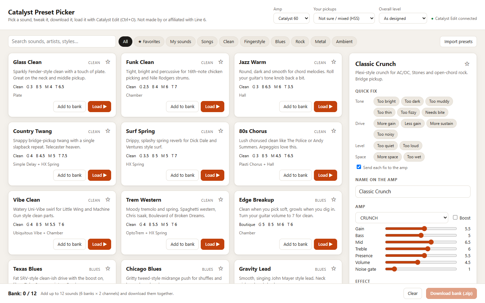
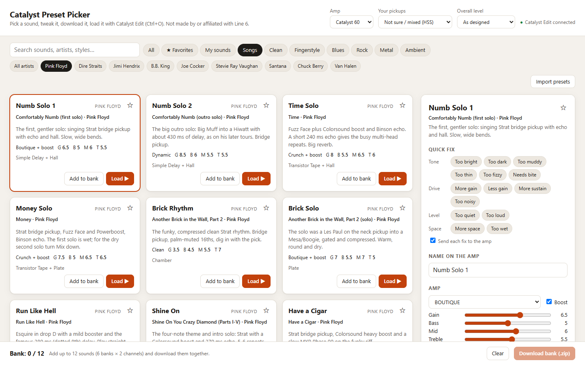

# Catalyst Preset Picker

196 ready-to-play sounds for the **Line 6 Catalyst** amps, plus a small app to browse, tweak and load them.
The sounds cover clean, blues, rock, metal, ambient and fingerstyle, plus 121 song sounds from Pink Floyd, Dire Straits,
Jimi Hendrix, B.B. King, Joe Cocker, Stevie Ray Vaughan, Santana, Chuck Berry and Van Halen.

Made and tested on a **Catalyst 60**. The app can also build presets for the Catalyst 100 and 200, but that hasn't been tested on a real amp.

Not made by or affiliated with Line 6. The song sounds are starting points based on public gear rundowns, not the artists' exact settings.

## What you need

| | Needed for | Where to get it |
|---|---|---|
| A Line 6 Catalyst amp and a USB cable | Everything | Plug straight into the PC, not through a USB hub |
| **Catalyst Edit** (free) | Loading presets onto the amp | [line6.com/software](https://line6.com/software/) |
| **Python 3** (free) | The **Load to amp** / **Save to slot** buttons (Windows only) | [python.org/downloads](https://www.python.org/downloads/) |
| A web browser (Chrome, Edge or Firefox) | The picker app | Already on your PC |

Optional: Line 6's **Catalyst ASIO driver** (same software page) is for recording and USB audio on Windows. Catalyst Edit
doesn't need it for presets, but if Catalyst Edit can't find your amp, installing it is worth a try.

## Install

1. **Get the files.** On this page, click the green **Code** button, then **Download ZIP**. Right-click the zip and choose
   **Extract All**. Use the extracted folder, not the files inside the zip.
2. **Install Catalyst Edit** from Line 6, connect the amp by USB, switch it on and check that Catalyst Edit shows your amp.
3. **Install Python 3** (only for the amp buttons). In the installer, tick **"Add python.exe to PATH"** before clicking Install.

## Use the picker

1. Open Catalyst Edit with the amp connected.
2. Double-click **`Start Preset Picker.bat`**. A black helper window opens, and the picker opens in your browser.
   Keep the black window open while you play; close it when you're done.
3. Click a sound, then **Load to amp** to hear it. Tweak it with the sliders or the quick fix buttons ("Too bright", "More gain", …).
   **Save to slot** stores it on the amp in the slot you pick, after asking you first.
   While it saves (about 10 seconds), don't click around in Catalyst Edit.

Also in the picker: search by song or guitarist, favorites (☆), a 12-sound bank to download in one go, and importing or
exporting your own sounds. Pick your amp model and pickup type at the top.

**Windows warning?** Because the .bat came from the internet, Windows may warn you before running it. On
"Windows protected your PC", click **More info**, then **Run anyway**; on a security warning, click **Run**.
The helper only runs on your own PC (127.0.0.1) and installs nothing.

**No Python, or not on Windows?** Double-click `Catalyst Preset Picker.html` instead. Everything works except the amp
buttons: click **Download .catl6p**, then load the file in Catalyst Edit with **Ctrl+O**.

## Just want the preset files?

The `.catl6p` files are in [`presets/`](presets), made for the Catalyst 60, in three versions to match your guitar:

| Folder | For |
|---|---|
| `Mixed (HSS)` | Guitars with mixed pickups, or if you're not sure |
| `Humbucker` | Les Paul, SG and other humbucker guitars |
| `Single coil` | Strat, Tele and other single-coil guitars |

Each folder is sorted by style, and the song sounds are in `Songs/<artist>`.
To load one: in Catalyst Edit press **Ctrl+O** and pick the file. To keep it on the amp, press **Ctrl+D** and choose a slot.

## Troubleshooting

- **"python is not recognized" or "Python was not found"**: Python isn't installed or wasn't added to PATH. Reinstall it with
  "Add python.exe to PATH" ticked, or use the HTML file as above.
- **"Open Catalyst Edit to load sounds"** in the picker: start Catalyst Edit, or wait a few seconds after starting it.
- **Save says Catalyst Edit isn't connected to the amp**: check that the amp is on and the USB cable is plugged in, and wait until
  Catalyst Edit shows a bank and channel.
- **Too loud or too quiet overall**: use **Overall level** at the top of the picker.

## Files

| File | What it is |
|---|---|
| `Start Preset Picker.bat` | Starts the picker with the amp buttons (runs `helper.py`) |
| `Catalyst Preset Picker.html` | The picker itself, also works opened directly |
| `presets.js` | Every sound's settings |
| `models.js` | Catalyst amp and effect parameters, generated by `make_models.py` from Catalyst Edit's own files |
| `helper.py` | Loads and saves to the amp through Catalyst Edit (Python standard library only) |
| `presets/` | Every sound as a `.catl6p` file |
| `screenshots/` | The pictures in this README |
| `export_all.js` | Rebuilds `presets/`: `node export_all.js presets` (needs [Node.js](https://nodejs.org)) |
| `build_share.js` | Builds a share zip in `dist/`: `node build_share.js` (needs Node.js) |
